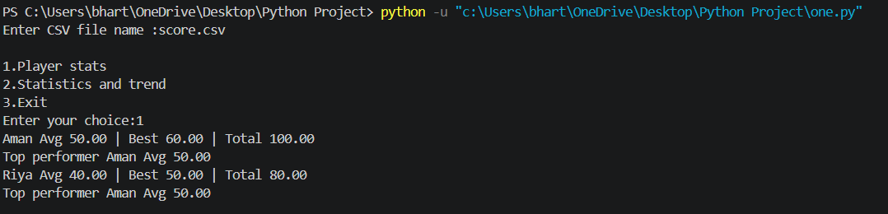
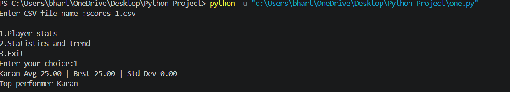
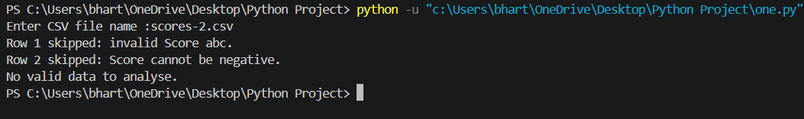
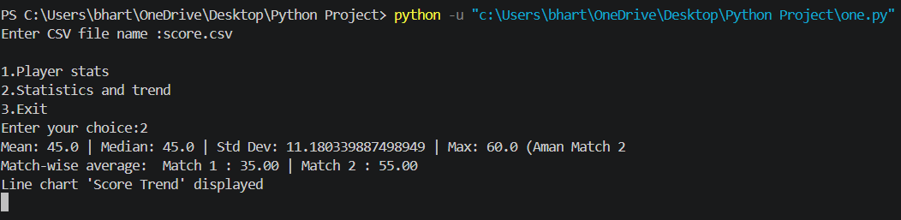
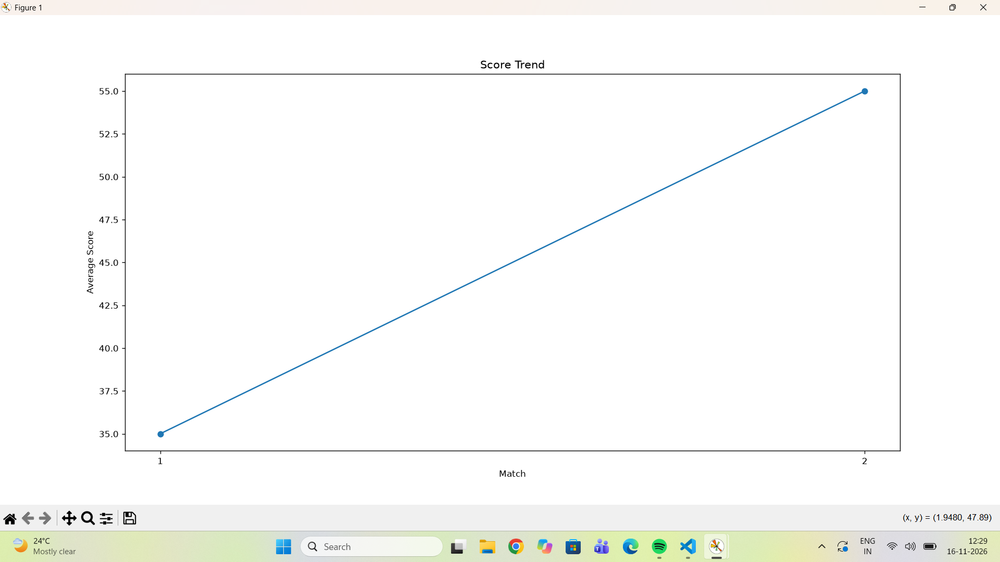
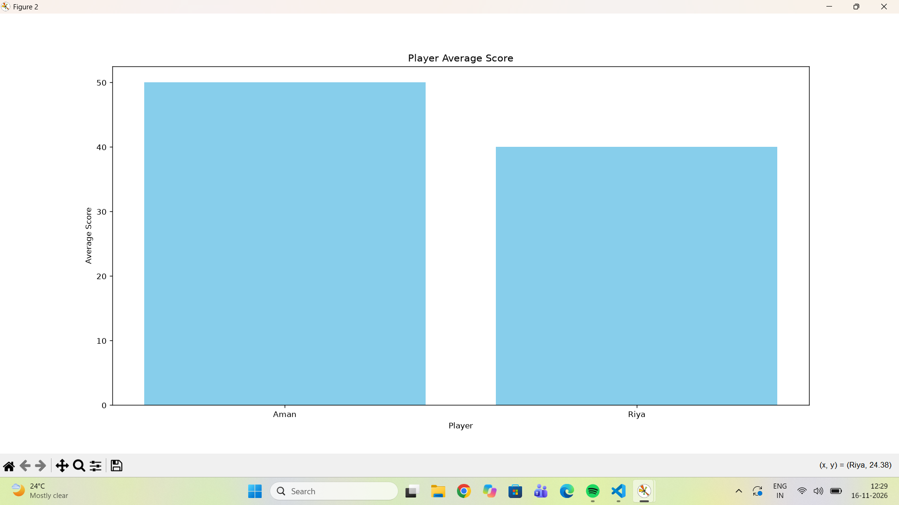

# Project Summary - Sports Performance Analyzer

## 1. Problem Statement
Build a program that loads players' match scores from a CSV file, cleans the data and analyses it to find each player's average and best score, the top performer and overall statistics, with charts.

## 2. How I Implemented It

**Step 1: Reading the file**
The program asks for a CSV file name (default `scores.csv`) and loads it with Pandas (`pd.read_csv`) using the columns Player, Match and Score. If the file is not found, it shows an error message.

**Step 2: Cleaning the data**
A `for` loop checks every row:
- If the Score is not a number (like `abc`), the row is skipped.
- If the Score is negative, the row is skipped.
- Valid rows are saved in a clean table (DataFrame).
If no valid rows are left, the program prints "No valid data to analyse." and stops.

**Step 3: Player stats (Menu option 1)**
`groupby("Player")` is used to find each player's average, best and total score. The player with the highest average is shown as the top performer using `idxmax()`.

**Step 4: Statistics and trend (Menu option 2)**
- NumPy is used to calculate the mean, median, maximum, minimum and standard deviation (`np.mean`, `np.median`, `np.max`, `np.min`, `np.std`).
- `groupby("Match")` gives the average score of each match.

**Step 5: Charts using Matplotlib**
- A line chart titled "Score Trend" shows the average score of each match.
- A bar chart titled "Player Average Score" shows each player's average.
Both have a title and axis labels.

**Step 6: Menu**
A `while` loop shows the menu: 1 Player stats, 2 Statistics and trend, 3 Exit.

## 3. Test Cases

### Test Case 1: Normal Input
Input: Aman,1,40 / Aman,2,60 / Riya,1,30 / Riya,2,50 (Menu option 1)

Expected output:
- Aman: Avg 50.00 | Best 60 | Total 100
- Riya: Avg 40.00 | Best 50 | Total 80
- Top performer: Aman (Avg 50.00)

### Test Case 2: Boundary / Minimum Input
Input: Karan,1,25 (one row only, Menu option 1)

Expected output:
- Karan: Avg 25.00 | Best 25 | Std Dev: 0.00
- Top performer: Karan

### Test Case 3: Invalid Input
Input: Aman,1,abc / Riya,1,-10

Expected output:
- Row 1 skipped: invalid Score 'abc'.
- Row 2 skipped: Score cannot be negative.
- No valid data to analyse.

### Test Case 4: Different Valid Scenario
Input: same CSV as Test Case 1 (Menu option 2)

Expected output:
- Mean: 45.00 | Median: 45.00 | Std Dev: 11.18 | Max: 60 (Aman, Match 2)
- Match-wise average: Match 1: 35.00 | Match 2: 55.00
- Line chart 'Score Trend' displayed

## 4. Challenges Faced
- Libraries were not installed at first, so I installed them with `pip install numpy pandas matplotlib`.
- I made small spelling mistakes in column names and colour names, which caused errors. I fixed them by reading the error message and the line number.
- The CSV file and the Python file had to be in the same folder so the program could find the file.

## 5. Conclusion
The program reads player scores, handles invalid input, finds each player's stats and the top performer, calculates overall statistics and shows the trend with charts. It passes all 4 test cases.